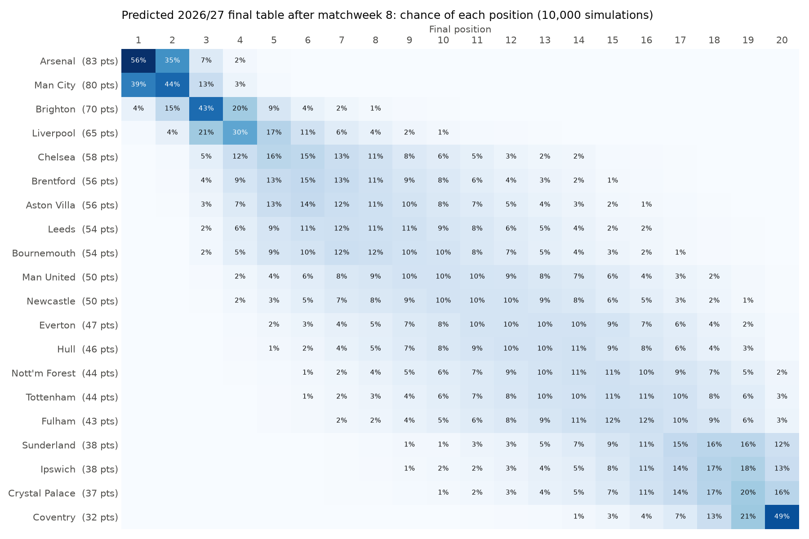

# Premier League Match Predictor

Predicts every 2026/27 Premier League scoreline and the final league table, then checks each prediction against the real result after every matchweek.

**Live site: [azwadtahmid.github.io/PremierLeaguePredictor](https://azwadtahmid.github.io/PremierLeaguePredictor/)**, updated automatically every morning.

- **Matchweek by matchweek:** each fixture with its predicted score, home/draw/away chances and the 3 most likely scorelines. Once played, the real score sits next to the prediction with a right/wrong verdict and points.
- **Predicted final table:** title, top 4 and relegation chances from 10,000 simulations of the rest of the season, with the change since the previous matchweek beside each team.
- **Honest track record:** predictions are locked about 48 hours before kick-off and never edited, then compared with "always pick the home team" and the Bet365 favourite.



## Results

Tested on the whole 2025/26 season (366 matches), which none of the models saw while being built:

| Model | Accuracy | Log loss |
|---|---|---|
| Always home win (baseline) | 42.1% | 1.086 |
| **Bet365 favourite (baseline)** | **48.9%** | **1.023** |
| Random forest (form features) | 45.1% | 1.064 |
| XGBoost (form features) | 45.4% | 1.066 |
| **Goals model (Poisson)** | **47.3%** | **1.029** |


**What this shows:**

- Every model beats "always home win", so the data carries real information.
- The **goals model** is the best by a clear margin, with a log loss close to the bookmaker's. It powers the website.
- Nothing beats Bet365. Its odds include injuries, line-ups, team news and the betting market, none of which are in this data, so that is the expected result.
- The random forest and XGBoost are almost identical. When two different methods land in the same place, the features are usually the limit, not the algorithm.
- Log loss scores the predicted probabilities, not just the pick. Lower is better, and guessing one-third for each result scores about 1.099.

**Scorelines:** the goals model's most likely scoreline was exactly right in **9.0%** of test matches, and the real score was in its top 3 in **29.2%**. Even the most likely scoreline usually has only a 10 to 15% chance.

### Draws are never predicted


No model, and not the bookmaker's favourite either, ever picks a draw. A draw is rarely the single most likely result of a match, even though draws were 27% of 2025/26. The probabilities still give draws their share (usually about 20 to 30%), which is where log loss gives credit.

### Which form features matter


Permutation importance for the random forest: shuffle one feature in the test set and measure how much worse the log loss gets. The home team's average shots and points matter most. Several away-team features score slightly below zero, which means they added nothing on 2025/26 data: last-5 form is a weak, noisy signal.

## How it works

### Data

- **Results and odds:** [football-data.co.uk](https://www.football-data.co.uk/), one CSV per season from 2015/16 (`E0` = Premier League), read straight from the site with pandas. 4,240 matches.
- **2026/27 schedule:** [fixturedownload.com](https://fixturedownload.com/), for matchweek numbers and kick-off times. Two club names are mapped to football-data's spelling (`Man Utd`, `Spurs`).

Checks in [`notebooks/01_explore.ipynb`](notebooks/01_explore.ipynb): no missing values in the columns used, team names spelled the same in every season, and dates that parse correctly even though 2016/17 uses two-digit years.

### Goals model (Poisson)

Gives every team an **attack** and a **defence** rating, plus one home advantage for the league:

```
expected goals = exp(base + attack[team] + defence[opponent] + home advantage)
```

The ratings are learned from past scores (scikit-learn's `PoissonRegressor`), with recent matches counting more: a match's weight halves every 180 days. Treating each side's goals as Poisson-distributed gives a probability for every scoreline from 0-0 to 10-10, and adding those up gives home win, draw and away win. The **predicted score** is the most likely scoreline for the most likely result, so a home-win pick always shows a home-win score.

**Promoted teams** have little or no recent Premier League data, and one lucky result would make them look like champions: without a fix, Hull had a 99% title chance after winning their opening game. So any team with less than 10 matches of recent data is topped up with typical promoted-team results: historically 1.0 goals scored and 1.76 conceded per game in their first season. Real results take over as they come in.

The 180-day half-life and the penalty strength were chosen on 2024/25, not on the test season. On the test season the model is **refit before every matchday** using only matches already played.

The current ratings are in [`models/goals_model.json`](models/goals_model.json), refreshed daily.

### Form models (random forest, XGBoost)

The original approach, kept as a benchmark and a second opinion. For each match, each team gets its average over its **previous 5 matches**: goals scored, goals conceded, shots, shots on target and points. That gives 10 features per match.

- **No data leakage:** the data is reshaped to one row per team per match and sorted by date, and the rolling average is taken after `shift(1)`, so a match never sees its own result. Checked by recomputing 200 random matches by hand.
- **Only recent form:** the 5 matches must come from the current or the previous season, so a team's results from years ago don't count as "form".

The trained random forest is [`models/model.joblib`](models/model.joblib).

### Predicted table

After each completed matchweek:

1. Build the table as it stood at the end of that matchweek.
2. List the remaining fixtures: every team plays every other team home and away, so it's all 380 pairings minus those played.
3. Get expected goals for each remaining fixture from the goals model.
4. Draw a random score for every fixture, add it to the table, and rank on points, then goal difference, then goals scored.
5. Repeat 10,000 times and count how often each team finishes in each position.

Each matchweek's table is saved in [`results/table_history.csv`](results/table_history.csv), which is where the week-on-week changes on the website come from.

### Live tracking and scoring

A [GitHub Actions workflow](.github/workflows/update.yml) runs every morning at 06:00 UTC:

1. `download.py`: the latest results and schedule.
2. `predict.py`: scores locked predictions that have been played, and **locks** a prediction for every fixture kicking off in the next 48 hours. Locked predictions go in `results/predictions.csv` (created when the first one is locked) and are never changed.
3. `simulate.py`: re-simulates the season once a matchweek is complete.
4. `site.py`: rebuilds the website data, then the workflow commits the changes.

**Scoring:** 3 points for an exact score, 1 for the right result. Matchweeks 1 to 6 were played before tracking began, so the website shows **backtest** predictions for them, made using only results from before each match, and labels them as such.

### Evaluation

- **Split by time**, never randomly: train 2015/16 to 2024/25, test 2025/26. A random split would let a model learn from matches played after the ones it is tested on.
- Baselines and models are scored on **exactly the same 366 test matches**.
- Nothing was tuned on the test season.
- Bookmaker probabilities come from Bet365 decimal odds: `1 / odds`, divided by their total to remove the bookmaker's margin.

## How to run

Requires Python 3.11+.

```bash
git clone https://github.com/azwadtahmid/PremierLeaguePredictor.git
cd PremierLeaguePredictor
python -m venv .venv
.venv\Scripts\Activate.ps1        # Windows PowerShell
# source .venv/bin/activate       # macOS / Linux
pip install -r requirements.txt

python src/download.py    # results -> data/matches.csv, schedule -> data/schedule.csv
python src/features.py    # form features -> data/features.csv
python src/train.py       # test every model on 2025/26, charts, models/model.joblib
python src/predict.py     # score and lock live predictions
python src/simulate.py    # predicted table after each completed matchweek
python src/site.py        # website data -> docs/data.json
```

To view the site locally: `python -m http.server --directory docs`, then open http://localhost:8000.

On macOS, if XGBoost fails with a `libomp` error, run `brew install libomp`.

## Project structure

```
.github/workflows/update.yml  daily automatic update
data/                         downloaded data (not in the repo; rebuilt by download.py)
docs/                         the website (GitHub Pages): index.html, app.js, style.css, data.json
models/model.joblib           trained random forest (form model)
models/goals_model.json       goals model team ratings, refreshed daily
notebooks/01_explore.ipynb    data quality checks and result shares
results/                      charts, test metrics, predictions log, table history
src/download.py               results and schedule
src/features.py               rolling last-5 form features
src/goals.py                  Poisson goals model: ratings, scorelines, H/D/A
src/schedule.py               schedule joined with results; completed matchweeks
src/train.py                  time split, baselines, all models, charts
src/predict.py                locks and scores live predictions
src/simulate.py               season simulation and table history
src/site.py                   builds docs/data.json for the website
```

## Limitations

- **No team news.** Injuries, line-ups, transfers and managers are much of what the bookmaker knows and this project doesn't.
- **Table odds are probably too confident.** The simulation treats each team's current rating as known and fixed for the rest of the season. In reality ratings are uncertain and change, so the real spread of outcomes is wider.
- **Early-season ratings are shaky,** especially for promoted teams, which lean on the promoted-team prior for their first ~10 games.
- **The goals model under-predicts draws** (23.7% on average in 2025/26, against 27.3% actual), a known weakness of treating each side's goals as independent.
- **One test season** of 366 matches. Differences of 1 to 2 points between models are within normal season-to-season variation.
- The pick is always the single most likely result, so draws are never picked. The probabilities are more useful than the picks.
