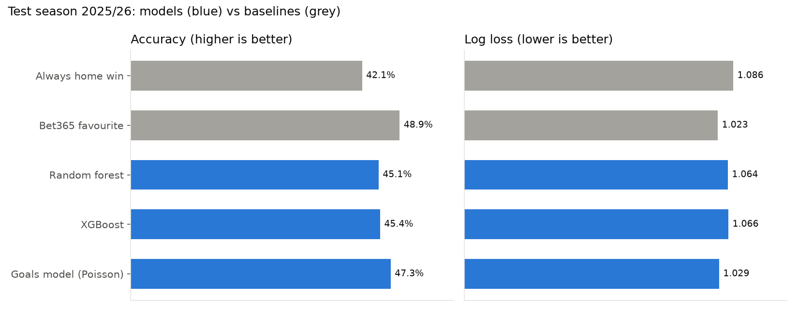
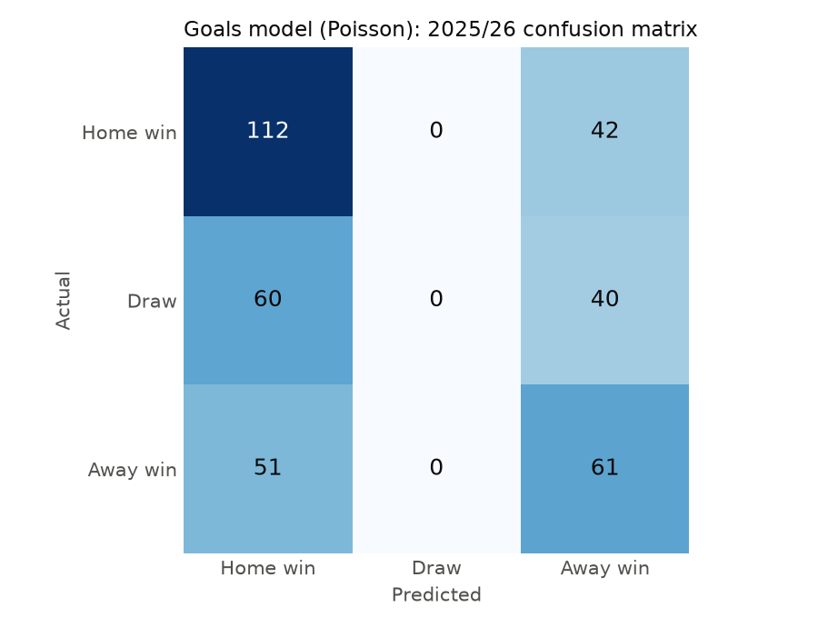
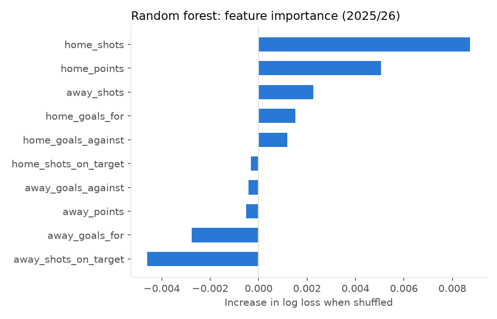

# Premier League Match Predictor

Predicts whether a Premier League match ends in a home win, draw or away win (H/D/A) from each team's recent form, then checks those predictions against two simple baselines: always picking the home team, and picking the bookmaker's favourite.

Trained on 2015/16 to 2024/25, tested on 2025/26, and used for live predictions during 2026/27.

## Results

Test season 2025/26 (366 matches):

| Model | Accuracy | Log loss |
|---|---|---|
| Always home win (baseline) | 42.1% | 1.086 |
| **Bet365 favourite (baseline)** | **48.9%** | **1.023** |
| Random forest | 45.1% | 1.064 |
| XGBoost | 45.4% | 1.066 |



**What this shows:**

- Both models beat "always home win" by about 3 percentage points, so recent form carries real information.
- Neither beats the bookmaker. Bet365's odds already include everything in these features plus injuries, line-ups, team news and the betting market, so this is the expected outcome rather than a failure. Closing that gap with form statistics alone would be surprising.
- The two models are almost identical. The random forest has the slightly better log loss, so it is the saved model.
- Log loss scores the predicted probabilities, not just the pick. Lower is better, and a model that always guessed one-third for each result would score about 1.099.

### Draws are never predicted



The model never predicts a draw, and neither does the bookmaker's favourite. A draw is rarely the single most likely result of a match, even though draws made up 27% of 2025/26. Picking the most likely outcome every time means draws are always missed. The predicted probabilities still give draws their share (typically 18 to 30%, median 24%), which is where log loss gives credit.

### Which features matter



Permutation importance: shuffle one feature's values in the test set and measure how much worse the log loss gets. The home team's average shots and points over the last 5 matches matter most. Several away-team features score slightly below zero, which means the model gains nothing from them on 2025/26 data: those signals are weak and partly noise.

## How it works

### Data

Match results and statistics from [football-data.co.uk](https://www.football-data.co.uk/), one CSV per season (`E0` = Premier League), read straight from the site with pandas. 12 seasons, 4,240 matches.

Checks done in [`notebooks/01_explore.ipynb`](notebooks/01_explore.ipynb): no missing values in the columns used, team names spelled the same in every season, and dates that parse correctly even though 2016/17 uses two-digit years. Bet365 odds are complete in all seasons, which is why they are the bookmaker benchmark.

Possession is not used: football-data.co.uk doesn't have it, and FBref removed its advanced stats in January 2026.

### Features

For each match, each team gets its average over its **previous 5 matches**:

- goals scored
- goals conceded
- shots
- shots on target
- points (3 win, 1 draw, 0 loss)

That gives 10 features per match: `home_…` and `away_…` versions of each.

**No data leakage.** A match's own goals, shots or result never appear in its own features. The data is reshaped to one row per team per match and sorted by date, and the rolling average is taken after `shift(1)`, so each match only sees earlier games. This was checked by recomputing 200 random matches by hand.

**Only recent form counts.** The 5 previous matches must come from the current or the previous season. Old matches don't show current form: Sunderland's last Premier League games before 2025/26 were in 2016/17. Matches where a team doesn't have 5 recent games are skipped. That covers the start of 2015/16 and the first 5 games of each promoted team, about 14 matches per season.

### Evaluation

- **Split by time**, never randomly: train 2015/16 to 2024/25, test 2025/26. A random split would let the model learn from matches played after the ones it is tested on.
- Baselines and models are scored on **exactly the same 366 test matches**.
- Model settings were fixed in advance, not tuned on the test season.
- Bookmaker probabilities come from Bet365 decimal odds: `1 / odds`, divided by their total to remove the bookmaker's margin.

The saved model is then refit on every complete season (2015/16 to 2025/26). 2026/27 stays unseen, so live predictions are a genuine out-of-sample test.

## Live predictions (2026/27)

`src/predict.py` predicts upcoming fixtures and logs them to `results/predictions.csv` (created on the first run that has fixtures) with H/D/A probabilities, the model's pick and the Bet365 favourite. Each time it runs, it first fills in the real results of earlier predictions and prints the running accuracy of the model, "always home win" and the Bet365 favourite.

Fixtures come from football-data.co.uk's `fixtures.csv`. If it doesn't list the next Premier League round yet, add the fixtures by hand to `data/upcoming.csv`:

```
Date,HomeTeam,AwayTeam
17/10/2026,Arsenal,Chelsea
```

Team names must match the spelling in the data (e.g. `Man United`, `Nott'm Forest`).

## How to run

Requires Python 3.11+.

```bash
git clone https://github.com/azwadtahmid/PremierLeaguePredictor.git
cd PremierLeaguePredictor
python -m venv .venv
.venv\Scripts\Activate.ps1        # Windows PowerShell
# source .venv/bin/activate       # macOS / Linux
pip install -r requirements.txt

python src/download.py    # all seasons -> data/matches.csv
python src/features.py    # form features -> data/features.csv
python src/train.py       # baselines, models, charts, models/model.joblib
python src/predict.py     # score past predictions, predict the next fixtures
```

After each matchweek, run `download.py`, `features.py` and `predict.py` again. Only re-run `train.py` to rebuild the model.

On macOS, if XGBoost fails with a `libomp` error, run `brew install libomp`.

## Project structure

```
data/                     downloaded data (not in the repo; rebuilt by the scripts)
notebooks/01_explore.ipynb   data quality checks and result shares
src/download.py           pulls every season, saves data/matches.csv
src/features.py           rolling last-5 form features
src/train.py              time split, baselines, random forest, XGBoost, charts
src/predict.py            predicts upcoming fixtures, scores and logs them
models/                   saved model (not in the repo; rebuilt by train.py)
results/                  charts, metrics.csv, predictions.csv
```

## Limitations

- Form only: no player availability, line-ups, transfers or managers, which are much of what the bookmaker knows.
- One test season of 366 matches. Accuracy differences of 1 to 2 points between models are within normal season-to-season variation.
- Predicting the single most likely result means draws are never picked. The probabilities are more useful than the picks.
- Newly promoted teams get no prediction for their first 5 games of a season.
